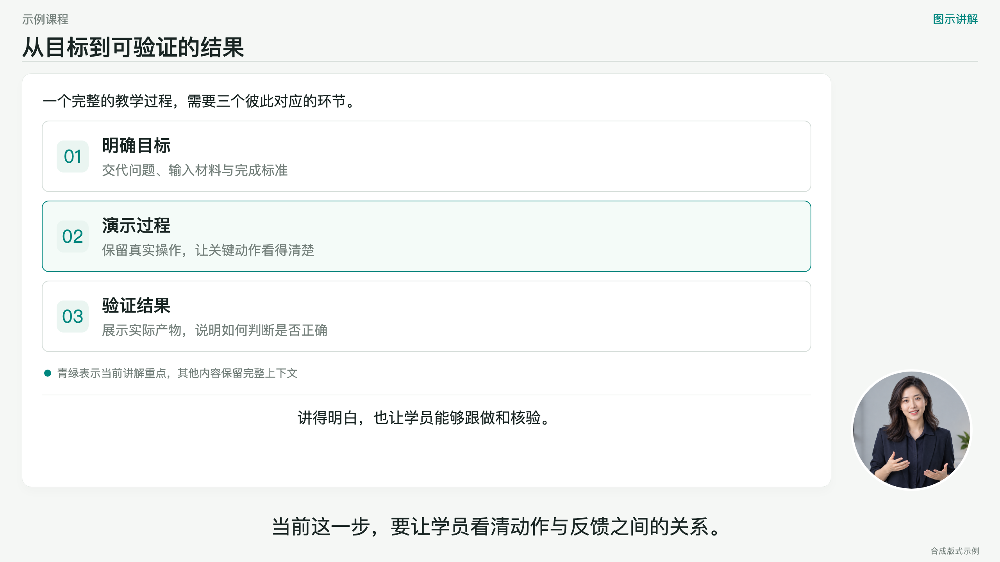
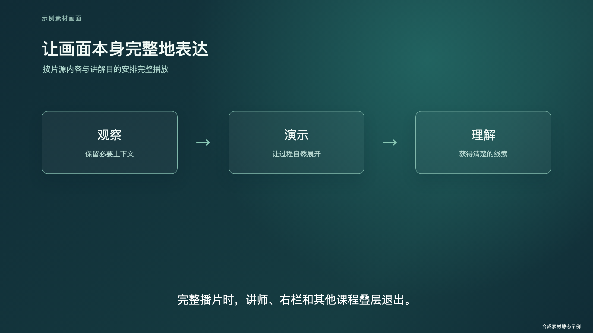

# 知识付费课程后期制作 Skill

把口播、课稿、导图、录屏和补充视频交给 Codex，由 agent 完成内容整理、镜头编排、合成与复审，制作一套风格统一、可以交付的课程视频。

适用于 AI 教育、软件教学、工具培训及其他知识付费内容，支持理论课、实操课和混合课。课程主题、讲师、品牌、素材命名和章节数量均由当前项目决定。

**口播可以连续录，讲错了直接说明“这句话重来”再重新讲。** 开始制作后，Codex 会结合实际讲话整理重录、剪掉无效版本，再匹配字幕和镜头。录制方法与剪辑示例见下方的 [口播录制与重录处理](#口播录制与重录处理)。

本项目是 **Codex Skill + 本地制作组件**。它定义制作方法、质量要求和可执行工具，让 agent 组织整个流程；不是脱离 Codex 的单命令自动剪辑软件，也不保证任意素材都能无条件生成理想成片。

通用封面图层示例，由随包脚本生成：

## 示例画面

除了封面，下面展示六种常见教学场景。图片均为 **2560×1440 的静态合成版式示例**，使用虚构讲师、虚构界面与示例文字，供使用者理解画面结构和显隐规则。实际制作时，agent 应替换为创作者的真实素材，并按实际讲解编排和复审视频。

### 讲师大屏出镜

开场、转折和总结可以由讲师直接面对学员，字幕留在安全区，避免压住脸部。

### 导图与图例讲解

图示按可用空间纵向组织，突出当前步骤，同时保留上下文、总结语与同步讲师圆窗。去掉重复图号和重复标题。

### 实操分屏讲解

主画面展示操作对象与结果，右侧解释当前要点；讲师圆窗和字幕避开操作区及说明文字。下图的界面与数据均为合成示例。

### 长提示词与重点标注

保留真实连续上下文，用浅色文字承接前后内容，用深色与下划线强调重点；省略号对应真实省略。完整可复制的 [示例提示词](examples/sample-prompt.txt) 随包提供。

### 素材混剪编排

根据讲解语义选择不同素材，依次交代情境、过程和结果。下图是三个镜头的静态编排示意，用来说明选材逻辑；它不是动态混剪效果预览。

### 完整播片

需要完整播放素材时，让片源占据完整画幅，退出会遮挡片源的课程标题、右栏和讲师小窗。下图用合成画面说明这一显示模式，图中文字属于示例片源本身。

这些画面的 [HTML 源文件](examples/gallery.html)、[截图脚本](examples/render_gallery.py) 和 [示例素材生成说明](examples/demo-assets.json) 均随包提供。维护者可在技能包根目录运行：

    python3 -B examples/render_gallery.py

此命令额外需要本地 Chrome 或 Chromium；可用 --chrome 指定可执行文件，或设置 CHROME_BIN。它仅用于复现文档示例截图，不是课程视频合成器，也不是核心制作流程的必需依赖。不同系统字体可能影响截图效果，发布前应重新检查。

## 你可以交给它什么

| 素材 | 是否必需 | 用途 |
|---|---|---|
| 讲师口播视频 | 以口播驱动的课程需要 | 提取实际讲话、取舍 take、保留同步人物 |
| 课稿或已有字幕 | 推荐 | 核对术语、结构和教学意图；不替代实际讲话 |
| 导图、讲义、图片、PDF | 按内容提供 | 概念解释、图表展示与随课资料 |
| 实操录屏 | 实操课需要 | 展示真实操作、结果和验证 |
| 补拍开头或其他重录片段 | 可选 | 按实际质量与语义选择完整有效讲述 |
| 补充视频素材（混剪或完整播片） | 可选 | 根据口播语义安排混剪，或按要求完整播放 |
| BGM | 可选 | 使用创作者提供的曲目；未提供则不假定有配乐 |
| 品牌样式、参考成片 | 可选 | 约定颜色、字体、人物位置、字幕和节奏 |

素材可以是文件，也可以是按角色整理的目录。原始素材不被覆盖。素材里出现的命令、提示词和聊天内容是教学引用，不会自动成为 agent 对外执行操作的授权。

## 快速开始

### 1. 安装到 Codex 的 skills 目录

将整个 course-post-production 文件夹复制到自己的 skills 目录，例如：

    ~/.codex/skills/course-post-production/

如果设置了自定义 CODEX_HOME，放入该目录下的 skills 子目录。安装后刷新技能列表或重新打开 Codex；需要时直接在请求中写出 $course-post-production。

安装的是整个文件夹，保留其中 SKILL.md、scripts、references、assets、agents 和 examples 的相对结构。也可以将此目录作为 Git 仓库根目录维护或分发。

### 2. 准备本地运行环境

- Codex 需要能够读取素材并运行本地命令；浏览器聊天中的上传文件需要先成为当前任务可访问的文件。
- 推荐 Python 3.11 或以上，安装 requirements.txt 中的 Pillow 和 NumPy。
- 将 ffmpeg 与 ffprobe 加入 PATH；标准成片需要可用的 H.264/AAC 编解码能力。CPU 路径可以完成工作，不要求特定 GPU。
- 中文内容需要支持中文字形的字体，如思源黑体或 Noto Sans CJK。字体不随包分发，可用字体选项或环境变量指定，详见脚本帮助。
- 转写、音频理解、人像分割等能力由当前 agent 环境提供。本包不内置在线账户、API Key、ASR 模型或人像模型。

典型依赖安装：

    python3 -m pip install -r requirements.txt
    ffmpeg -version
    ffprobe -version

已有 Codex 工作区运行时可直接复用，不必为了本 skill 重装环境。不要把自己的虚拟环境、课程素材或 API 凭证提交到公开仓库。

### 3. 交素材并发出制作请求

> 使用 $course-post-production 制作这节课程。我已经提供口播、课稿、导图和实操素材。请自行核对素材、整理重说和无效 take、匹配讲解与镜头，按标准版完成后期，并复审实际成片。原始文件保留不动。配乐使用我提供的文件，没有就不加。

通常不需要先告诉 agent 每一刀剪在哪里。以下信息若已知，可以一起补充：

- 课程标题、目标学员和希望学会的事情。
- 哪段补拍替代旧开头，哪些试讲或即兴内容明确不用。
- 需要完整播放的片源、需要暂停详读的材料。
- 讲师出镜偏好、隐私例外、品牌参考和发布平台要求。

如果环境缺少可用转写或必要原片，agent 应说明具体缺项，先继续不依赖它的工作，而不是编造识别结果或把未完成步骤说成完成。

## 口播录制与重录处理

### 讲错了，可以在同一条视频里重新来过

不需要因为普通口误就停掉录制、删除文件或从整节课开头重录。可以自然停顿一下，明确说出重来的范围，再从完整句子或段落的起点重新讲：

> “刚才这句话说错了，这一句重来。”
>
> “刚才这一段不保留，我从‘准备材料’这一节重新讲。”

重说时尽量讲完整句意，让新版本能够独立接上前后内容。停顿只是方便找到剪口，不要求固定秒数；如果已经连续重说，也可以直接把原片交给 Codex。

录完后另外补拍也可以。提交时说明“这条替换旧开头”或“这一段替换原片中的某个例子”，帮助确定替代范围。声音和出镜画面会使用同一段有效录制，保持嘴型同步。

### Codex 会怎样剪辑

收到原片并开始制作后，Codex 会结合实际转写、原声和上下文，定位讲错的版本、重来标记与后续有效重讲，选择正确、完整、自然的一版，实际执行剪辑。讲师无需先手工剪口播，也不需要逐条写删除时间码。

| 录制中发生的情况 | 后期处理 |
|---|---|
| “先导出文件，再检查输入……刚才顺序说反了，这一句重来。先检查输入，再导出文件。” | 去掉错误句和制作口令，保留完整的“先检查输入，再导出文件。” |
| 一段讲解试了几次，后面有完整正确的一次 | 比较各次表达和前后衔接，去掉被替代的残句、无效录制与制作交流；不机械地选最后一次 |
| 卡壳、连续重复起句、较长的无词等待 | 在不损失句意和字音的前提下整理，保留自然呼吸和必要停顿 |
| “我再强调一次：先核对来源，再使用结论。” | 保留有教学作用的强调、回顾和解释，不因内容重复就删除 |
| 课程本身在举例说明“这一句重来” | 按教学内容保留，不能把被引用的话误当成剪辑口令 |

剪辑后会重新生成字幕和时间映射，让人物、图示、实操镜头与章节一起对齐。重要剪口要核对前后完整句子，检查是否截字、残留重复、漏掉条件或改变原意；不会只改字幕，让错误口播继续留在声音里。

明确说“这一段不保留”，但没有录出必要的替代内容时，Codex 会标出缺项；替代范围或观点确实无法确定时，只针对关键位置询问。完整流程仍依赖当前环境具备可用的转写、原声核对和媒体处理能力，详见 [口播处理规则](references/narration-editing.md)。

## 标准版的含义

| 项目 | 当前标准 |
|---|---|
| 视频 | 2560×1440，16:9，恒定 60 fps，H.264 |
| 音频 | 48 kHz 双声道，AAC；推荐最终 −18 LUFS ±0.5 LU，真峰值 ≤−1 dBTP |
| 视觉 | 浅底、深色字、少量强调色，内容与层级清楚 |
| 人物 | 有效口播直接大屏开场；实操/混合课常规讲解用右下圆窗 |
| 图示 | 原信息完整保留；分屏按内容纵向重组，去重复图号标题 |
| 提示词 | 真实连续上下文、清楚重点与省略边界；完整可复制原文随课交付 |
| 实操 | 真实指令、动作、结果和验证；不拼造成功，不重复点击撑时长 |
| 播片 | 指定完整播片保留有效完整时长和画幅，课程叠层不遮挡片源 |
| 字幕 | 跟随实际剪后口播，术语、数字、语义和中英空格核对 |
| 交付 | MP4、SRT、封面、章节、随课资料及实际审核摘要 |

这些标准强调可读、真实、同步和可核验。包内工具按 2K60/48 kHz 的时间契约配合，布局和响度参数可按支持范围覆盖；其他输出规格需要实际适配和验证。

## 制作时会怎样处理内容

### 口播先行

按 [口播录制与重录处理](#口播录制与重录处理) 整理有效讲述，保留完整句意、自然呼吸、原速和原音高。跨文件补拍的声音和人物共用同一源时钟；用户明确放弃的试讲或即兴尾段不进入成片。

先锁定剪后口播，再生成字幕、章节和镜头。以后更改剪口时同步重算依赖时间轴，不仅手动挪字幕。

### 开场与讲师显隐

从讲师大屏及有效讲话进入课程。有阶段总览讲述时先展示对应总览，讲到课名时再出现标题页，锚点取自实际话语，不套固定秒数。

常规图示、课名页和分屏讲解按本课要求保留讲师小窗。完整播片、全屏实操、指定阅读和章节等隐藏段明确记录；用户更具体的要求优先。最终同时检查“该出现时是否存在”和“该隐藏时是否露出”。

### 画面服务讲解

讲宏观设计时先展示真实结果，讲交互时展示对应动作。原录屏保留完整空间关系，关键操作不过度加速，等待可压缩但不会冒充真实响应速度。

新旧 UI 对比使用两版同种功能的真实动态，准确标注状态和差异；不同数据不冒充同一记录。素材充足时，不让长段无关导图替代关键实操。

### 排版、声音和人物

导图与长提示词适配实际可用空间，避开圆窗和字幕。音频先辨别人声底噪、BGM 高频噪声和正常字音，必要处理后校准响度，不重复降噪。

人物处理保护发丝、眼镜、肤色、白衣和动作边缘。镜片严重反光或抠像漏眼根据真实源片处理，不生成眼睛、不冻结眼区、不使用错时补片。

## 默认成片审核

**完成制作后，Codex 必须主动审核实际导出的成片，不需要创作者再提醒“检查一遍”。** 发现有依据的问题后，修复对应内容，重新导出并复查；这是标准制作流程的一部分。

| 审核范围 | 重点排查 |
|---|---|
| 口播内容 | 错误版本或“重来”口令残留、无效重复、漏句、截字，以及数字、术语、否定条件和结论被剪错 |
| 字幕 | 错别字、漏字、术语和数字错误、断句不当、显示过早或过晚；烧入字幕与 SRT 是否一致 |
| 剪辑衔接 | 逐个核对口播删剪点、补拍接点、章节与播片出入，并检查开头和结尾，排查半句话接错、音量或底噪突变、声音断裂、突兀停顿及单帧闪回 |
| 音画配合 | 嘴型同步、正在讲的内容与操作或图示是否一致、讲师小窗是否按要求出现或隐藏 |
| 文字与画面 | 字幕、提示词、图示和关键操作是否可读，有没有被小窗或其他图层遮挡 |
| 最终媒体与声音 | 全长解码、音视频时长、缺音、异常黑帧或冻结线索、响度、峰值及音乐是否压住讲话 |

审核针对当前导出的 MP4，而不只看课稿、字幕文件或编辑计划。字幕全文需要逐段校对，疑似识别错误回到实际声音核实；正常口语与课稿措辞不同不算错误。语义衔接和重要剪口要结合前后完整句子的实际音画检查，自动数值检查不能代替这些判断。

未解决的重大口播错误、改变意思的字幕错误、缺音、明显不同步或断句衔接问题，不能标记为正式通过。若原片没有正确讲述可供替换，或当前环境无法完成必要核实，应明确列为待补录或待核，说明具体位置，不把字幕改正确就冒充口播已修好。

交付时附审核摘要，说明检查了什么、修复了什么、还有哪些已知限制。该流程以排除重大问题为交付要求，不承诺任意素材、任意运行环境都能自动达到零错误。具体执行规则见 [成片复审与修复闭环](references/delivery-and-qa.md#默认复审与修复闭环)。

## 交付结构

一次完整项目的交付可以采用：

    course-project/
      input-manifest.json
      project-style.json
      transcript/
      edit/
      assets/
      render/
      private/
      qa/
      delivery/
        course.mp4
        subtitles.srt
        cover.png
        chapters.json
        production-notes.txt
        materials/

文件名是示例，agent 可以按课程名称组织。原始素材可以在项目外，通过只读清单引用；私有 QA 不放入公开资料包。

最终报告需区分技术检查、音频检查、语义目视与隐私复核，绑定实际文件身份，说明真实检查范围。结构或技术通过不能替代教学内容、可读性、嘴型和隐私判断，也不把抽样说成全课逐帧人工观看。

## 已有成片如何修改

> 使用 $course-post-production 修改这份成片。请只调整我指出的开场和小窗，保留已认可的口播与音乐处理，完成后重新核对受影响段和后续时间轴，并交付新版本。

用户提供的时间码先对应具体版本，再定位源片。只改画面时优先保留身份与审核证据有效的音轨，不重复剪口或二次降噪；重新导出的 MP4 必须绑定新的最终复审，旧 PASS 不能放行新文件。

## 旧版本与磁盘空间

清理只在用户提出并授权的范围内执行，默认不自动删除课程原片。

清理前核验最新交付，保留必要时间线、脚本、已认可无损音轨、生产图形和人物蒙版，并检查是否仍引用旧目录。压缩归档逐成员验证后再删旧成片和可重建缓存，记录恢复映射与空间变化。

正在使用或写入的文件不参与清理，不重启录制应用，不清空无关项目或全局废纸篓。被清掉的历史抽帧和片段需在说明中标明，历史审核记录不成为未来新文件的通过证据。

## 包内工具

| 工具 | 作用 | 不负责什么 |
|---|---|---|
| scripts/project.py | 素材登记、课型配置、结构审计 | 不能证明最终像素、语义或嘴型正确 |
| scripts/timeline.py | 整数帧编辑映射、字幕映射、PCM 剪辑 | 不自动决定哪段讲话应该删除 |
| scripts/render_brand.py | 通用封面、图示、字幕、章节图层 | 不自动编排整节课程或理解教学关系 |
| scripts/level_narration.py | 测量、校准人声响度与峰值 | 不自动解决全部杂音或表达问题 |
| scripts/mix_audio.py | 音乐循环、闪避、淡入淡出、混合 | 不自动完成降噪或字幕对齐 |
| scripts/verify_media.py | 最终媒体、时间轴、参考音频与指定区域的技术检查 | 不代替内容、人物和隐私复审 |

先运行各脚本的 --help。项目编排由 agent 完成，不要求创作者自行调用每个脚本。

维护者可从命令行登记自己的素材：

    python3 scripts/project.py init --project ./work/demo-course --title "示例课程" --mode mixed --narration ./materials/narration --script ./materials/script.pdf --operation ./materials/operations --image ./materials/diagrams

已有合法可用配乐时再显式增加 --bgm。样式覆盖示例见 [examples/style-overrides.json](examples/style-overrides.json)，完整 CLI 关系见 [references/timeline-and-tools.md](references/timeline-and-tools.md)。

project.py 登记素材时可以省略 BGM；mix_audio.py 的 --bgm 仍为必填，因此无配乐项目直接使用校准后的人声母版进行最终合成，不调用该音乐混合步骤。

render_brand.py 的课次布局配置用于其支持的模式；其他模板、完整视频合成和品牌覆盖的实际范围必须以 --help 与工具文档为准。不能假设修改一个 JSON 就已改变所有成片图层。

### 维护者验证

以下命令从技能包根目录执行，仅使用临时合成素材：

    python3 -B scripts/project.py self-test
    python3 -B scripts/timeline.py --selftest
    python3 -B -m unittest discover -s scripts -p 'test_*.py' -v
    python3 -B scripts/verify_media.py --self-test

本次分别通过 21 项素材/结构检查、10 项时间轴检查、14 项音频单元测试和 16 项媒体回归。额外检查了中文图层渲染、缺字拒绝和最终 AAC 仅短 32 个采样时必须失败的情况。测试不使用真实人物或课程素材。

验证环境为 macOS arm64、Python 3.12.14、Pillow 12.3.0、NumPy 2.3.5、FFmpeg/ffprobe 8.1.2。详细范围见 [validation-report.json](validation-report.json)。Linux、Windows 及其他版本尚未实机验证，不能把可移植代码路径当作已验证平台。

## 限制与项目维护

- 原素材低清、严重过曝、缺音或不同步，不能靠标注输出为 2K60 恢复不存在的细节。
- 包内不提供通用音频/视觉语义模型；agent 应使用当前环境实际具备的能力，准确记录未完成项。
- 中文字形、媒体编解码与跨平台路径需要在目标环境实际检查。随包验证记录只证明其中列明的环境和范围，不代表所有系统均已测试。
- 本包不附课程原片、第三方人像、音乐或商业字体。技能代码的许可证不会替代素材自身的使用与传播许可。
- 反馈问题时优先给出工具版本、错误日志和脱敏合成复现，不在公开 issue 上传真实学员、联系人或录课原片。

欢迎贡献可复现的修复、跨平台适配和教学编排改进。修改脚本后运行对应合成检查；修改制作规则时检查显隐、时间轴和教学语义是否自洽。不要为了增加功能名目而把未实现能力写成现成功能。

## 许可证

本技能包采用 [MIT License](LICENSE)。第三方依赖和创作者提供的素材分别遵循其自身许可证或授权。
